# Hi there, I'm Amiko! 👋

<!-- Theme-Sensitive Header Banner -->
<picture>
  <source media="(prefers-color-scheme: dark)" srcset="readmefile/dark.svg">
  <source media="(prefers-color-scheme: light)" srcset="readmefile/light.svg">
  
</picture>

 

## 🚀 About Me
I'm **Amiko**, a 3rd year **IT student at BTU** in **Tbilisi, Georgia 🇬🇪** and an **IT Support Intern at RSM Georgia Solutions**. I'm aiming for a **junior .NET developer** role, so I build original projects on my own: **ASP.NET Core Web APIs**, frontends, and data analytics tools.

> 💡 *"Ship small, learn fast, refactor often."*

- ⚙️ **Backend:** ASP.NET Core Web APIs in C#
- 🎨 **Frontend:** UIs on top of my own APIs
- 📊 **Data:** SQL Server data warehousing (star schemas, SCD Type 2, ETL) and analytics tools
- 🤖 **AI-Assisted Dev:** skilled with Claude & ChatGPT agents to plan, build, debug and review code faster
- 🎓 **Education:** IT @ BTU
- 💬 **Ask me about:** C#, .NET, building REST APIs from scratch
- ✉️ **Contact:** [a.davlasheridze111@gmail.com](mailto:a.davlasheridze111@gmail.com)
- 🐙 **GitHub:** [github.com/AmikoDavlasheridze](https://github.com/AmikoDavlasheridze)
- 🔗 **LinkedIn:** [linkedin.com/in/amiko-davlasheridze](https://www.linkedin.com/in/amiko-davlasheridze-02622537b/)

---

## 🛠️ Technical Skills

### 💻 Languages

### ⚙️ Backend & API

### 🗄️ Databases & Data

### 🤖 AI & Agents

### ☁️ Tools

